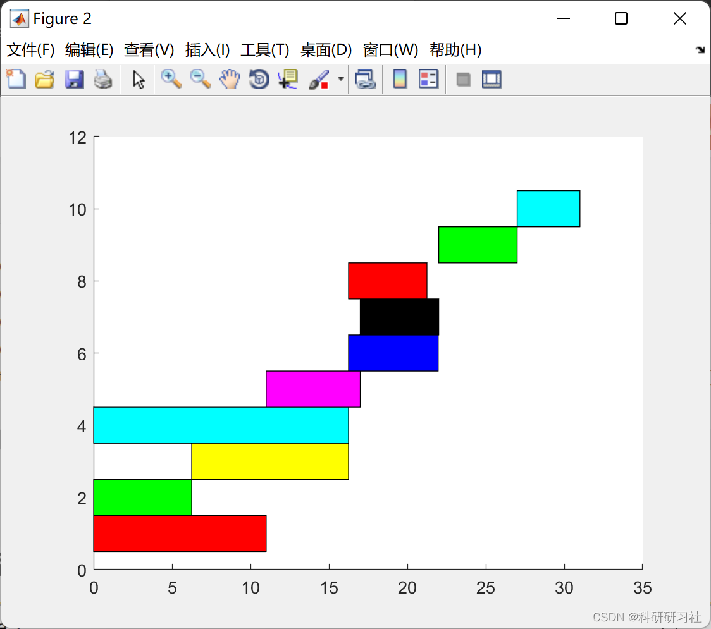
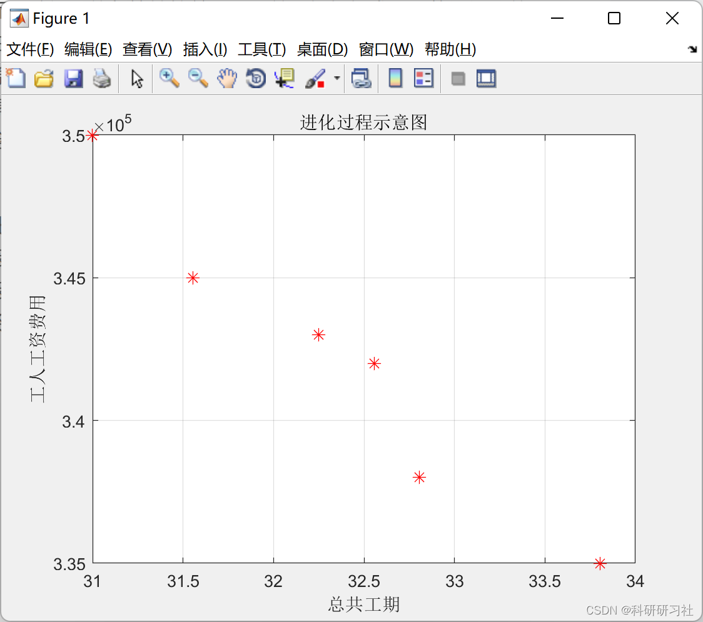
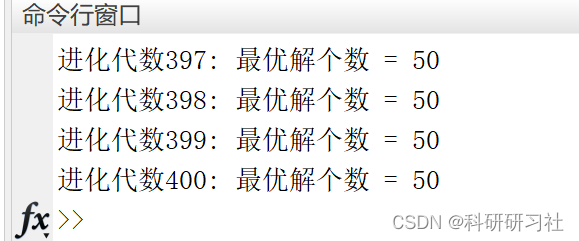

# Multi-skilled Employee Scheduling with Multi-Objective Genetic Algorithm (Matlab Code Implementation)

1. Overview
The crew (Crew) is assigned a number j as its identification, each crew having specific task capabilities (such as being capable of performing certain tasks but not others); for the tasks within their capability, due to differences in the composition of personnel and the equipment configurations available, crews have varying operational efficiency (efficiency represented by the number of hours completed per task). The classification of crews into different types (Crew_Type) is based on their task capabilities and operational efficiency, meaning that crews with similar categories achieve equal operational efficiency when completing the same task.
For business managers, how to reasonably assign employees to complete tasks is an important means to reduce operating costs and enhance product development in enterprises. Modern enterprises need to establish a scientific method for task assignment to achieve maximum benefits. Generally speaking, this type of problem can be categorized as a dispatching issue. However, with social development, the complexity of personnel types has increased. Tasks often have a sequence and priority relationship.
Traditional methods typically first model this issue mathematically. During this process, relevant characteristics of the problem are considered and expressed in mathematical language. Then, optimization can be conducted using linear programming or other methods to obtain schedule results. However, since the real world is not always linear, the mathematical model of the problem will contain nonlinear components. Generally, some methods can be used to transform the nonlinear parts of the model into linear parts, such as introducing auxiliary decision variables, to achieve the effect of solving traditional methods. These methods have good effects without disrupting the mathematical model and are thus widely studied and applied. However, this approach may lead to discrepancies between the mathematical model and the real world.
On the other hand, as the dimensionality of the problem increases, employee scheduling often becomes a multi-objective optimization problem. When optimizing the problem, objective functions such as completion time and employee wages need to be considered. In general, we define a multi-objective optimization problem as follows:
In response to the above-mentioned issues, Evolutionary Multiobjective Optimization (EMO) algorithms are increasingly receiving widespread attention in the academic community. Inspired by the natural evolution of organisms adapting to their environment, EMO algorithms simulate the process of evolution to search for the optimal solution to a problem. Due to its flexibility and ability to handle nonlinear problems, EMO algorithms can provide Pareto optimal solutions when there are only a few objectives, such as 2 or 3-objective optimization problems. Therefore, they have been applied to many engineering problems. The full article is available in Section 3.
2 Matlab Code Implementation: Only part of the code is presented here; for the complete code and detailed article, click the link:  
Multi-Objective Genetic Algorithm Based on Multi-Skill Staff Scheduling (Matlab Code Implementation)
%% Decoding\nglobal m Rjd salary Tjd_min\n\n% Assign tasks in the order of their task sequence until completion\nFTd = zeros(1,m); % Task Completion Time\nSTd = zeros(1,m); % Start time of the task\nFTpd = zeros(1,m); %The completion time of the preceding work\nTd = zeros(1,m); % The duration of task d\ntotal_salary = 0;\nnext_time_work = zeros(1,40); % Helper variable\n\na=-log(0.91)/log(2);\nb=-log(1-0.04)/log(2);\n\n%The basic idea is to update the Tijd table after each task allocation.\nindex = 1;\ne_index = 1;\nrecord = [];\nfor i=1:1:m\n    % Check the completion time of previous work\n    if i==3\n        STd(i) = FTd(2);\n    end\n    if i==5\n        STd(i) = max(FTd(1),FTd(2));\n    end\n    if i==6\n        STd(i) = max(FTd(1),FTd(4));\n    end\n    if i==7\n        STd(i) = max(FTd(3),FTd(5));\n    end\n    if i==8\n        STd(i) = FTd(3);\n    end\n    if i==9\n        STd(i) = max(FTd(6),max(FTd(7),FTd(8)));\n    end\n    if i==10\n        STd(i) = FTd(9);\n    end\n    \n    % Find the skills needed\n    skill = find(Rjd(:,i)==1);\n    needtime = zeros(1,numel(skill));\n    for j=1:1:numel(skill)\n        % Find the relevant personnel\n        worker = x(index);\n        total_salary = total_salary + salary(worker);\n        needtime(j) = Tijd(worker,skill(j),i);\n        %Check when workers can start work\n        if STd(i) > next_time_work(worker) % The worker is idle at the start of the task\n            %buganshenme\n        else % The worker is busy when the task starts.\n            needtime(j) = needtime(j) + next_time_work(worker) - STd(i);\n        end\n        next_time_work(worker) = STd(i) + needtime(j);\n        record(index,:) = [worker i skill(j) STd(i) next_time_work(worker)];\n        index = index+1;\n    end\n    Td(i) = max(needtime); % The duration is the maximum working time of a worker.\n    % After assigning a task, update Eij.\n    for j=1:1:numel(skill)\n        % Find the relevant personnel\n        worker = x(e_index);\n        Eij(worker,skill(j)) = Eij(worker,skill(j)) * (needtime(j)^a) * (Td(i)-needtime(j))^b;\n        % Update T table\n        Tijd(worker,skill(j),i) = Tjd_min(skill(j),i)/Eij(worker,skill(j)); \n        e_index = e_index+1;\n    end\n    \n    FTd(i) = STd(i) + Td(i);\nend\n\nfinal_date = max(FTd);\n\nz=[final_date;total_salary];\n\nfigure\ncolor=['r','g','y','c','m','b','k','r','g','c',];\nfor i=1:m\n    rec(1) = STd(i);% The horizontal coordinates of a rectangle\n    rec(2) = i-0.5;  % The vertical coordinate of a rectangle\n    rec(3) = FTd(i)-STd(i);  %The length of the x-axis direction in a rectangle\n    rec(4) = 1;\n    rectangle('Position',rec,'LineWidth',0.5,'LineStyle','-','FaceColor',color(i));%draw every rectangle\nend\n  
3. Running Results Editing
Editor
Editor
4. References [1] Zhang Jianmin, Wu Xinmao, Chen Yajun, Xiao Feng, Wang Jianhui, and Zhang Fayuan. Optimization Model and Algorithm for Mobile Work Scheduling in Power Supply Companies [J]. Electric Power System Automation, 2013, 37(14): 81-88
​  

## Images

<!-- PAYMENT_BLOCK -->

## Get this dataset

- Payment link (Stripe): [Buy now](https://buy.stripe.com/3cs8yP7sY87d0vu9AB)
- Payment QR code: 

<!-- /PAYMENT_BLOCK -->
